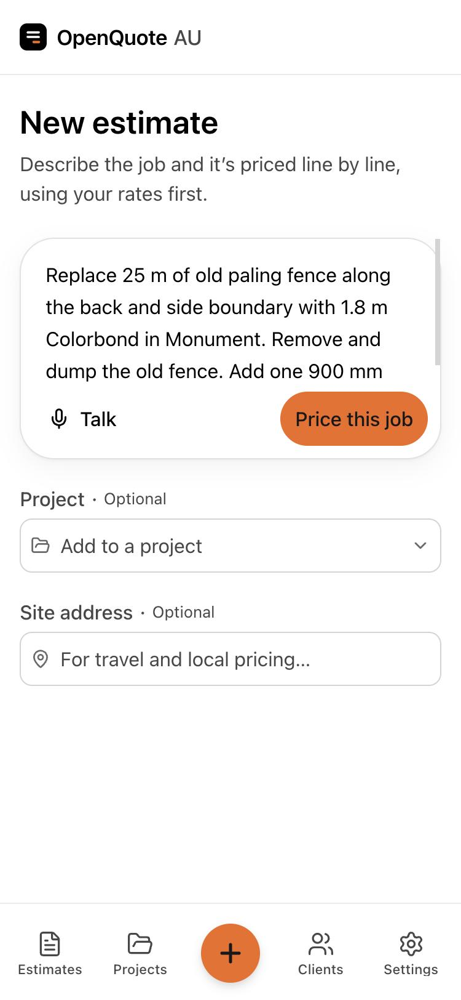
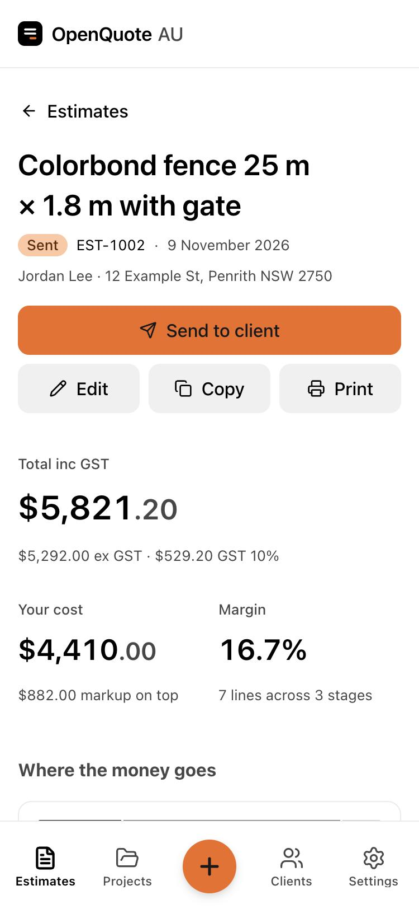
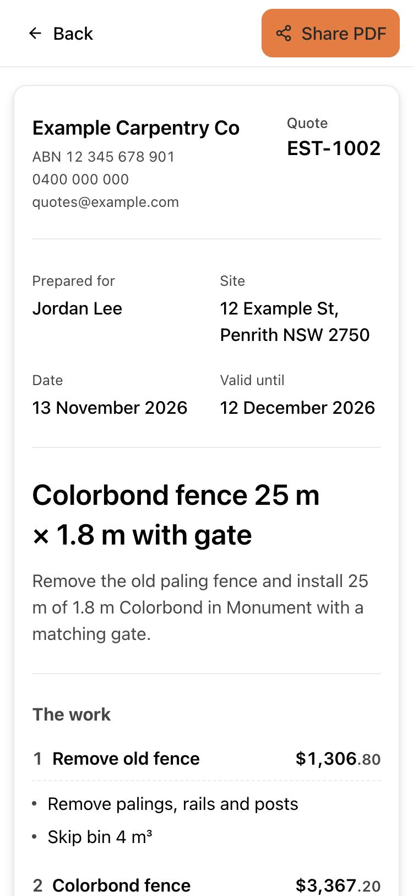
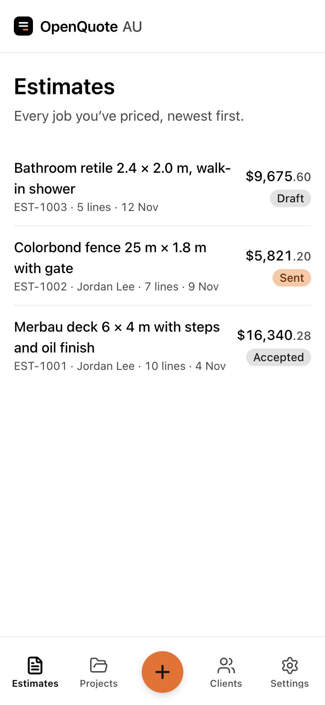

# OpenQuote AU

Free, open-source AI quoting for tradies, on your iPhone. Describe a job the way you'd tell a mate on the phone,
and OpenQuote AU breaks it into stages and prices every line with your own rates. Edit it, then send it to your
client as a PDF from your phone.

**Try it:** open **https://openquote-au.pages.dev** in Safari on your iPhone and add it to your Home Screen.

- **Price a job in under a minute.** Stages, quantities, labour and materials, with your rates used first.
- **Real prices, not guesses.** A built-in price book of checked material prices, and calculators that work out
  fences and decks post by post and board by board. Anything the AI had to estimate is marked "Check price".
- **Edit anything.** Change quantities, prices and descriptions, and add or remove lines and stages.
- **Send it.** A clean PDF quote with your logo and terms, shared by text, WhatsApp or email from your phone. Mark
  it accepted or declined when the client answers.
- **Everything stays on your phone.** No account to make and no server holding your quotes. They're saved on the
  phone, and the app reminds you to back them up to a file.
- **Costs nothing to run.** Pay only for the AI you use: with your own AI key (a few cents a quote), or a publik
  plan.

<p>
  
  
  
  
</p>

## Get it on your iPhone

**The easy way (no computer, never expires):** open **https://openquote-au.pages.dev** in Safari on your iPhone,
tap **•••** → **Share** → **View More** → **Add to Home Screen**, and leave **Open as Web App** on. OpenQuote then has
its own icon and opens full screen like any other app, even with no signal. Your quotes are saved on your phone,
not on a server.

**The native app (needs a Mac):** a Mac with Xcode (free), your iPhone and a USB cable. A free Apple ID works, but
Apple makes apps installed this way stop opening after 7 days, so you plug in and run the install again each week
(your data stays). Step-by-step instructions: [ios/README.md](ios/README.md).

Either way, set up your business, then add your AI key in **Settings → AI** (or sign in with publik). To move your
quotes from one to the other: **Settings → Your data → Back up to a file**, then **Restore from a file** in the other.

## What it costs

| | |
|---|---|
| OpenQuote AU | Free (AGPL-3.0) |
| Running it | Nothing: there's no server or database to pay for |
| AI | Your own key, pay-as-you-go (typically a few cents per estimate), or a publik plan |

**Prices are a starting point for Melbourne, Victoria (checked October 2026).** The built-in price book covers
fencing, decking and carpentry materials. Labour times haven't been checked by a tradie yet. Your own rates in
**Settings → Rates and pricing** always come first, so set those up, especially outside Victoria.

## Your data and privacy

**Your quotes stay on your phone.** OpenQuote AU has no account and no server holding anyone's data. Everything you
enter (business details, rates, clients, quotes) is saved inside the app on your phone: in the iPhone app, a SQLite
database in its Library folder, included in the phone's iCloud backups; in the Home Screen version, the same
database in that app's own storage on the phone.

**What leaves your phone, and only when you do it:**

- **Pricing a job:** your job description, site address and rates go to the AI service you chose (Anthropic,
  OpenAI, Google, OpenRouter, your own Ollama, or publik) to be priced. Nothing else is sent.
- **Sharing:** the quote PDFs and backup files you choose to send.
- **Sign in with publik** (only in the publik version): publik learns that you use the app and counts app opens.
  It never sees your quotes.

**Who else is involved:** the Home Screen version's files are served by Cloudflare Pages, which sees that the app
was loaded, like any website, and passes publik requests on without keeping them. Nobody else gets anything: no
analytics, no ads, no tracking.

**Backups:** **Settings → Your data → Back up to a file** saves everything to one file you can keep in iCloud
Drive, Files or email; **Restore from a file** brings it back on the same phone or a new one. The app reminds you
when it's been a while. AI keys are never put in backups: in the iPhone app they're in the Keychain, in the Home
Screen version in that app's storage.

**Moving from the old web version?** `npx tsx scripts/export-from-web.ts` reads your business from its database
(`DATABASE_URL` in `.env.local`) and writes a backup to `exports/`. Install with
`./ios/install-on-iphone.sh --data "exports/<name> from web.oqbackup"` to start with it on the phone.

## Sign in with publik

When OpenQuote AU is listed on [publik](https://publikhq.com), it opens behind **Sign in with publik**, and people
can pay for AI with their publik plan instead of their own key. It switches on once publik's app token is in
`publik-app-token.txt` at the top of the repo (publik issues it when the app is listed; committing it is intended).
Without that file the app opens straight away and uses each person's own AI key.

- **iPhone app:** `ios/App/App/Publik.swift` (publik's Swift module).
- **Web version:** `src/lib/publik-web.ts`, the same steps in the browser. Publik's API doesn't take calls from web
  pages, so the web version goes through a small relay on its own site, `functions/publik` (a Cloudflare Pages
  function that passes requests to publikhq.com/api/v1 and keeps nothing).

## For developers

Prerequisites: Node 22+. For the iPhone app, a Mac with Xcode.

```bash
npm install
npm run dev                    # http://localhost:5173, the whole app in a browser (data in IndexedDB)
npm run ios                    # build the app's screens and copy them into the Xcode project
```

| Script | What it does |
|---|---|
| `npm test` | Unit tests (Vitest) |
| `npm run typecheck` | `tsc --noEmit` |
| `npm run lint` | ESLint |
| `npm run db:generate` | New migration in `src/db/migrations` from `src/db/schema.ts` changes (the app applies it on launch) |
| `npm run ai:try -- "job description"` | Run the AI estimate pipeline once with `ANTHROPIC_API_KEY` |
| `npm run bench` | Run the reference jobs and compare them with earlier results and market prices (spends AI credit) |

**Stack:** React, TypeScript, Vite and React Router · the Astryx design system and Tailwind · SQLite in the app
(sql.js) with Drizzle ORM · Vercel AI SDK, calling the AI provider straight from the phone · Capacitor for the
iPhone app, with a small native plugin (`ios/App/App/OpenQuoteNative.swift`) for the Keychain, PDFs and Sign in
with publik · Vitest. Product spec and data model: [SPEC.md](SPEC.md). Design system: [DESIGN.md](DESIGN.md).

**Principles:**

- **Money is integer cents, ex-GST.** GST is applied once, on the document total.
- **Prices come from data.** `src/lib/price-book/items.json` holds the checked material prices (date, region and
  sources included); `src/lib/estimate/assemblies.ts` holds the fence and deck rules.
- **The LLM proposes, code prices.** The model outputs structured line items; all arithmetic lives in
  `lib/pricing.ts`.
- **Every change is a version.** AI and manual edits write an `estimate_versions` snapshot.

## Contributing

Bug reports, ideas and pull requests are welcome. See [CONTRIBUTING.md](CONTRIBUTING.md). To report a security
problem privately, see [SECURITY.md](SECURITY.md).

## License

[AGPL-3.0](LICENSE). You can use, change and share OpenQuote AU for free. If you run a modified version for other
people to use over the internet, you must share your changes under the same license.

OpenQuote AU is an independent project. It contains no code, prompts or assets from any commercial quoting tool.
Estimates are a starting point; check every quote before you send it.
