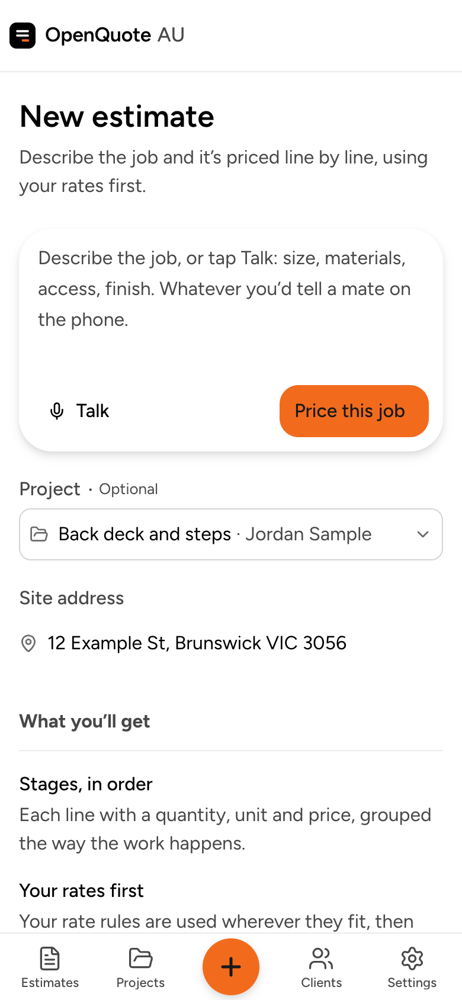
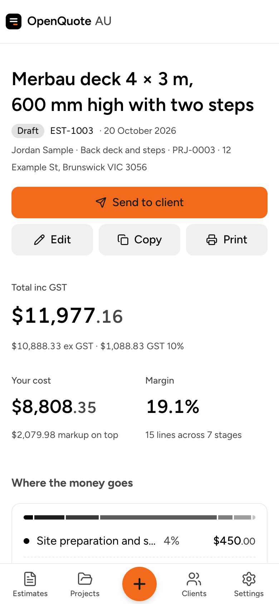
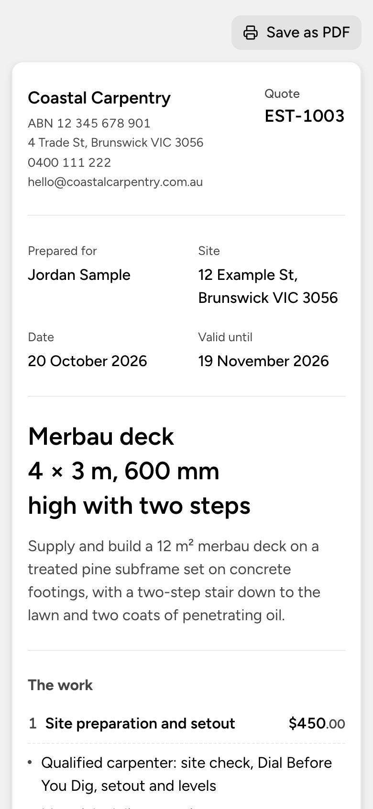
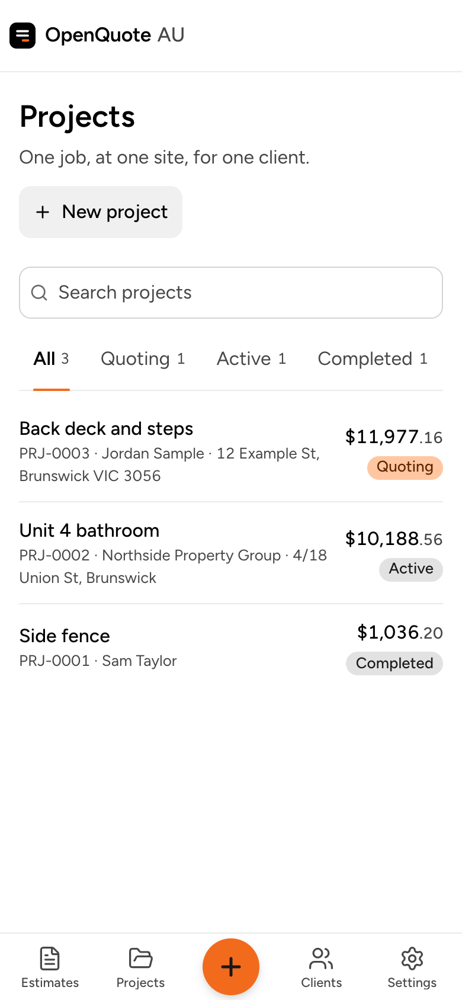

# OpenQuote AU

Free, open-source AI quoting for tradies, as an iPhone app. Describe a job the way you'd tell a mate on the phone,
and OpenQuote AU breaks it into stages and prices every line with your own rates. Edit it, then send it to your
client as a PDF from your phone.

- **Price a job in under a minute.** Stages, quantities, labour and materials, with your rates used first.
- **Real prices, not guesses.** A built-in price book of checked material prices, and calculators that work out
  fences and decks post by post and board by board. Anything the AI had to estimate is marked "Check price".
- **Edit anything.** Change quantities, prices and descriptions, and add or remove lines and stages.
- **Send it.** A clean PDF quote with your logo and terms, shared by text, WhatsApp or email from your phone. Mark
  it accepted or declined when the client answers.
- **Everything stays on your phone.** No account to make, no website, no server. Your quotes are saved on the
  iPhone and included in its iCloud backup, and you can back up to a file any time.
- **Costs nothing to run.** Pay only for the AI you use: with your own AI key (a few cents a quote), or a publik
  plan.

<p>
  
  
  
  
</p>

## Get it on your iPhone

**The easy way (no computer, never expires):** open **https://openquote-au.pages.dev** in Safari on your iPhone,
tap **•••** → **Share** → **View More** → **Add to Home Screen**, and leave **Open as Web App** on. OpenQuote then has
its own icon and opens full screen like any other app, even with no signal. Your quotes are saved on your phone,
not on a server.

**The native app (needs a Mac):** a Mac with Xcode (free), your iPhone and a USB cable. A free Apple ID works, but
Apple makes apps installed this way stop opening after 7 days, so you plug in and run the install again each week
(your data stays). Step-by-step instructions: [ios/README.md](ios/README.md).

Either way, set up your business, then add your AI key in **Settings → AI** (or sign in with publik). To move your
quotes from one to the other: **Settings → Account → Back up to a file**, then **Restore from a file** in the other.

## What it costs

| | |
|---|---|
| OpenQuote AU | Free (AGPL-3.0) |
| Running it | Nothing: there's no server or database to pay for |
| AI | Your own key, pay-as-you-go (typically a few cents per estimate), or a publik plan |

**Prices are a starting point for Melbourne, Victoria (checked October 2026).** The built-in price book covers
fencing, decking and carpentry materials. Labour times haven't been checked by a tradie yet. Your own rates in
**Settings → Rates and pricing** always come first, so set those up, especially outside Victoria.

## Your data

Everything is in one SQLite database inside the app (Library/OpenQuote on the phone), which the iPhone includes in
its iCloud and computer backups. **Settings → Account → Back up to a file** saves a copy you can keep in Files,
Drive or email, and **Restore from a file** brings one back, on the same phone or a new one. AI keys are kept in
the iPhone's Keychain and never go into backups.

**Moving from the old web version?** `npx tsx scripts/export-from-web.ts` reads your business from its database
(`DATABASE_URL` in `.env.local`) and writes a backup to `exports/`. Install with
`./ios/install-on-iphone.sh --data "exports/<name> from web.oqbackup"` to start with it on the phone.

## For developers

Prerequisites: Node 22+. For the iPhone app, a Mac with Xcode.

```bash
npm install
npm run dev                    # http://localhost:5173, the whole app in a browser (data in IndexedDB)
npm run ios                    # build the app's screens and copy them into the Xcode project
```

| Script | What it does |
|---|---|
| `npm test` | Unit tests (Vitest) |
| `npm run typecheck` | `tsc --noEmit` |
| `npm run lint` | ESLint |
| `npm run db:generate` | New migration in `src/db/migrations` from `src/db/schema.ts` changes (the app applies it on launch) |
| `npm run ai:try -- "job description"` | Run the AI estimate pipeline once with `ANTHROPIC_API_KEY` |
| `npm run bench` | Run the reference jobs and compare them with earlier results and market prices (spends AI credit) |

**Stack:** React, TypeScript, Vite and React Router · the Astryx design system and Tailwind · SQLite in the app
(sql.js) with Drizzle ORM · Vercel AI SDK, calling the AI provider straight from the phone · Capacitor for the
iPhone app, with a small native plugin (`ios/App/App/OpenQuoteNative.swift`) for the Keychain, PDFs and Sign in
with publik · Vitest. Product spec and data model: [SPEC.md](SPEC.md). Design system: [DESIGN.md](DESIGN.md).

**Principles:**

- **Money is integer cents, ex-GST.** GST is applied once, on the document total.
- **Prices come from data.** `src/lib/price-book/items.json` holds the checked material prices (date, region and
  sources included); `src/lib/estimate/assemblies.ts` holds the fence and deck rules.
- **The LLM proposes, code prices.** The model outputs structured line items; all arithmetic lives in
  `lib/pricing.ts`.
- **Every change is a version.** AI and manual edits write an `estimate_versions` snapshot.

## Contributing

Bug reports, ideas and pull requests are welcome. See [CONTRIBUTING.md](CONTRIBUTING.md). To report a security
problem privately, see [SECURITY.md](SECURITY.md).

## License

[AGPL-3.0](LICENSE). You can use, change and share OpenQuote AU for free. If you run a modified version for other
people to use over the internet, you must share your changes under the same license.

OpenQuote AU is an independent project. It contains no code, prompts or assets from any commercial quoting tool.
Estimates are a starting point; check every quote before you send it.
